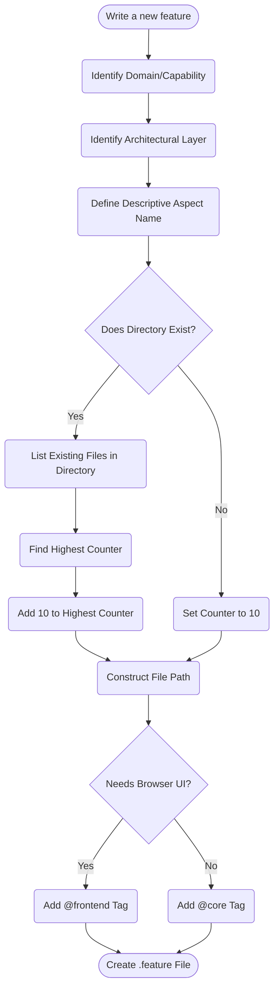

# Development Workflow Diagrams

These diagrams describe the [development cycle](DEVELOPMENT_CYCLE.md) at two granularities:
the full idea-to-shipped lifecycle, and the file-placement decision within Phase 2 (Specify).

## 1. The Full Development Cycle

```mermaid
flowchart TD
    Start([Task appears on the board]) --> Phase0[Phase 0: Pick Up Task]
    Phase0 --> ReadExisting{Existing feature file, ADR, or spec?}
    ReadExisting -- Yes --> ReadIt(Read every relevant document)
    ReadExisting -- No --> Phase1[Phase 1: Plan & Align]
    ReadIt --> Phase1[Phase 1: Plan & Align]
    Phase1 --> Plan(Produce step-by-step plan)
    Plan --> Review{Trivial / mechanical?}
    Review -- No --> Interview(Review / interview to align scope)
    Review -- Yes --> Phase2[Phase 2: Specify BDD First]
    Interview --> Phase2
    Phase2 --> ArchDec{Significant architectural decision?}
    ArchDec -- Yes --> ADR(Write an ADR first)
    ADR --> FeatureFile(Write declarative .feature file)
    ArchDec -- No --> FeatureFile
    FeatureFile --> Track(Track task on the board)
    Track --> Phase3[Phase 3: Implement Red-Green-Refactor]
    Phase3 --> Stubs(Implement step definitions)
    Stubs --> Code(Write production code until steps pass)
    Code --> Commits(Intermediate commits as checkpoints)
    Commits --> Phase4[Phase 4: Close]
    Phase4 --> Checks{All BDD pass AND no critical analyze errors AND closing commit exists?}
    Checks -- No --> Phase3
    Checks -- Yes --> Move(Move item to done with summary)
    Move --> ADR2{New architectural decision?}
    ADR2 -- Yes --> WriteADR2(Add ADR)
    ADR2 -- No --> Edge{New edge case?}
    WriteADR2 --> Edge
    Edge -- Yes --> NewFeature(Add edge case as a .feature file)
    Edge -- No --> Manual{User explicitly confirms completion}
    NewFeature --> Manual
    Manual -- Yes --> Done([Done — cycle repeats])
    Manual -- No --> Phase3
```

## 2. Phase 2 Detail — Placing a New Feature File

## Example Walkthrough (Phase 2)

1. **User asks**: "Add a test for user password reset API endpoint."
2. **Domain**: `users`
3. **Layer**: `api`
4. **Aspect**: `password_reset`
5. **Check**: `features/users/api/` exists. Highest file is `authentication-10.feature`.
6. **Counter**: `10 + 10 = 20`.
7. **Path**: `features/users/api/password_reset-20.feature`.
8. **Tag**: `@core` (API test, no browser).

Before that file is created, the lifecycle expects a plan and scope alignment for anything non-trivial (Phase 1), and after the file is created the implementation must run red → green → refactor (Phase 3) before the task may be closed (Phase 4).
