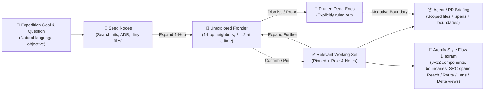

# ADR 0029: Graft Expeditions — Goal-Directed Subgraph Exploration & Persistent Working-Set Memory

- **Status**: Proposed (Future Sub-Project — Design & Architecture Roadmap)
- **Date**: 2026-11-01
- **Authors**: knightb8, Antigravity
- **Theoretical Foundation**:
  - Corey L. Lanum, *Visualizing Graph Data* (Manning, 2017), Chapter 6, Section 6.3 (*"Data volumes: Expanding nodes to add data — draw query results, not databases"*)
  - [tt-a1i/archify](https://github.com/tt-a1i/archify) ([archify.si/gallery](https://archify.si/gallery)) — Source-backed interactive architecture, workflow, sequence, and delta diagrams compiled from typed JSON IR

---

## 1. Context & Problem Statement

In Chapter 6 (Section 6.3.1) of *Visualizing Graph Data*, Corey L. Lanum identifies the most common failure mode in graph visualization tools:

> *"The novice mistake is throwing the entire data set on the screen hoping patterns will emerge. A very powerful strategy for graph visualization is to **draw query results, not databases**. You want your users to indicate what they want to see... and then allow the user to **expand** on that graph incrementally as they explore."*

Currently, Graft's visualizers (`Cosmos`, `Stacked Flow`, `Fishbone`, `Chord Wheel`) operate primarily in **Top-Down / Whole-Graph Filtering Mode**:
1. The entire repository graph is loaded onto the canvas and filtered down via Tri-State directory checkboxes, scope chips, or a transient single-node blast trace.
2. When investigating a specific architectural question, bug, or feature design, neither the human developer nor an autonomous AI coding agent has a **persistent, goal-scoped memory** of:
   - What **question or goal** is driving the current exploration;
   - Which nodes/files have been **confirmed as relevant** (`pinned` to the working set);
   - Which nodes/files have been **inspected and ruled out as irrelevant** (`pruned` dead-ends that should stay hidden);
   - Which neighboring nodes sit on the **unexplored frontier** waiting to be triaged;
   - How to hand off that curated subgraph directly to a coding subagent without re-discovering the codebase from scratch.

Because this requires coordinated state across the CLI, on-disk storage, the interactive canvas, and agent context export, it constitutes a dedicated sub-project: **Graft Expeditions**.

---

## 2. Decision Drivers

1. **Goal-First Epistemic Framing**: Every exploration starts with an explicit natural-language **Goal / Question** (e.g., *"Trace all parser modules and BDD specs needed to support Gherkin scenario outlines"*).
2. **Progressive Ego-Network Disclosure (Lanum Ch. 6.3)**: Instead of plotting 1,000+ nodes and hiding 950 of them, an Expedition canvas starts with **only the seed nodes** (1–5 nodes) and grows organically as the user double-clicks to expand outward (2–12 neighbors per expansion) without triggering global re-layouts that destroy spatial memory.
3. **Positive & Negative Memory (Relevant vs. Pruned)**: Remembering what is *not* relevant is just as valuable as remembering what *is* relevant. Once a branch or utility module is marked **Irrelevant / Pruned**, subsequent neighborhood expansions must automatically suppress it.
4. **Human ↔ Agent Handoff**: An Expedition saved in the interactive visualizer (or assembled via CLI) should be directly consumable by an AI agent as a zero-noise context briefing (`graft expedition context <name>`), enforcing strict file boundaries.
5. **Git-Friendly Persistence**: Expeditions should serialize as clean, human-readable Markdown/JSON artifacts (e.g., under `.graft/expeditions/<slug>.expedition.json` or `docs/expeditions/`) that can optionally be committed or shared alongside an ADR or PR.

---

## 3. Proposed Architecture: The "Expedition" Model



### 3.1 Data Schema (`ExpeditionState`)

```ts
export type ExpeditionNodeStatus =
  | "seed"       // Initial entry point(s) for the question
  | "relevant"   // Confirmed part of the working set
  | "excluded"   // Explicitly ruled out / pruned dead-end
  | "frontier";  // 1-hop neighbor currently surfaced for triage

export type ExpeditionNodeRole =
  | "governance"   // Governing ADR or architectural doc
  | "spec"         // BDD .feature specification
  | "target-edit"  // Production source file to be modified
  | "contract"     // Read-only dependency interface / type contract
  | "verification" // Test file covering the behavior
  | "context";     // General reference

export interface ExpeditionEntry {
  nodeId: string;
  status: ExpeditionNodeStatus;
  role?: ExpeditionNodeRole;
  note?: string;          // Why this node is relevant or why it was ruled out
  addedAt: string;        // ISO-8601 timestamp
  discoveredVia?: {       // Provenance of how this node entered the expedition
    fromNodeId: string;
    relation: string;
  };
}

export interface ExpeditionLogStep {
  timestamp: string;
  action: "seed" | "expand" | "mark_relevant" | "mark_excluded" | "annotate";
  nodeIds: string[];
  detail?: string;
}

export interface GraftExpedition {
  id: string;             // e.g. "sankey-blast-consistency"
  title: string;          // Human-readable title
  question: string;       // The driving question / goal statement
  createdAt: string;
  updatedAt: string;
  entries: Record<string, ExpeditionEntry>;
  trail: ExpeditionLogStep[];
}
```

---

### 3.2 Interactive Canvas Workflow ("Expedition Mode" in `graft viz`)

1. **Starting an Expedition**:
   - User clicks **"New Expedition"** (or selects a node and clicks *"Start Expedition from Node"*), enters the **Goal / Question**, and picks initial seed nodes via search, git-dirty status, or ADR selection.
2. **Progressive Radial Expansion (Lanum Sec 6.3.1 & 6.4.1)**:
   - The canvas displays **only** `seed`, `relevant`, and active `frontier` nodes.
   - Double-clicking any `seed` or `relevant` node queries its immediate 1-hop neighbors in the full graph (excluding any node already marked `excluded`).
   - Following Lanum's **2-to-12 Rule**, if a node has $>12$ neighbors, they are grouped by relation/directory combo first so the canvas never explodes into a hairball.
   - New `frontier` nodes animate outward radially from the expanded parent over `280ms`, while existing nodes remain anchored in place.
3. **Triage Controls (Pin vs. Prune)**:
   - Selecting a `frontier` node offers quick single-key / badge actions:
     - **`[R]` Mark Relevant (`✓`)**: Promotes the node into the permanent working set and lets the user tag its role (`target-edit`, `contract`, `spec`, `verification`) and optional note.
     - **`[X]` Mark Irrelevant / Prune (`✕`)**: Collapses the node and its exclusively dependent subtree into the `excluded` list so it never reappears during this expedition.

---

### 3.3 CLI & Autonomous Agent Integration

Expeditions bridge visual human discovery and autonomous coding subagents:

- `graft expedition create "<title>" --question "<goal>" --seed <node-id>`
- `graft expedition status <id>` — prints the Tripartite summary of `relevant` nodes (ADRs, Specs, Code targets, Tests), `frontier` candidates, and `excluded` boundaries.
- `graft expedition export <id> --format agent-prompt` — generates a ready-to-dispatch subagent prompt containing:
  1. The **Expedition Goal & Question**;
  2. **Strict File Boundary** (`target-edit` vs. read-only `contract` files with exact `file:line` spans);
  3. **Governing ADRs & BDD `.feature` files**;
  4. **Explicit Negative Constraints** (`excluded` files that were investigated and ruled out, preventing agent drift).

---

### 3.4 Archify-Style Curated Flow Diagrams & Typed IR Target (`tt-a1i/archify`)

A major output target for a completed (or in-flight) **Graft Expedition** is generating **curated, source-backed interactive flow diagrams** inspired by [tt-a1i/archify](https://github.com/tt-a1i/archify) ([archify.si/gallery](https://archify.si/gallery)):

1. **Why Graft + Archify Fit Together Naturally**:
   - **Archify's Golden Rule**: *"Show 8–12 core components, one primary path, external dependencies, and trust boundaries. Put supporting detail in cards instead of adding more edges."*
   - **Graft's Ground-Truth AST Index**: Where an LLM using Archify normally has to grep files and hand-author `sources: [{ path, line, end_line, label }]`, Graft *already possesses* the exact `file:line–end_line` spans, symbol definitions, and verified causal edges in its context graph.
   - **Expedition as the Curation Funnel**: A raw repository graph has 500–5,000 nodes (too large for a cleanschematic diagram), whereas an **Expedition's `seed ∪ relevant` working set** is already distilled down to the 8–15 nodes that answer a specific architectural question.

2. **Supported Archify-Style Diagram Targets from an Expedition**:
   - **Signal-Flow Architecture View (`diagram_type: "architecture"`)**:
     - Renders each `relevant` Expedition node as a structured component card (`label`, `sublabel`, role badge, `tag`, and clickable `SRC n` badge pinned to Graft's `file:line` spans).
     - Automatically wraps subsystem directories or Tripartite scopes (`adrs`, `specs`, `code`, `tests`) in enclosing boundary boxes (`kind: "region" | "security-group"`).
     - Distinguishes the primary causal path (`variant: "emphasis"` with animated signal-flow pulses) from contract/governance links (`variant: "security"`) and secondary references (`variant: "dashed"`).
   - **Workflow & Sequence Views (`"workflow"` / `"sequence"`)**:
     - Traces an ordered execution or verification path across the Expedition's `trail` (e.g., `CLI Entry -> Parser -> Graph Assembler -> Exporter`), showing callers, callees, and exception/fallback branches across swimlanes.
   - **Architecture Delta View (`Before / Delta / After`)**:
     - Compares two Graft graph snapshots or an Expedition's planned modifications (`target-edit` nodes) to highlight `added`, `removed`, `changed`, and `moved` components and links during PR/design review.
   - **Interactive URL Deep-Linking & Lenses**:
     - `#focus=<component>&reach=downstream|upstream` — isolates upstream provenance or downstream blast reach within the schematic diagram.
     - `#route=<from>~<to>` — illuminates the exact multi-hop signal route between two components.
     - `#lens=<roleA>~<roleB>` — filters the schematic to compare specific architectural layers (e.g., `spec~code` or `code~verification`).
   - **Supporting Narrative Cards (`cards[]`)**:
     - Compiles the Expedition's `question`, `note` annotations, and `excluded` dead-end rationale into bottom summary cards (`Source-backed dispatch`, `Governing ADRs & Specs`, `Ruled-out paths`) instead of cluttering edges with long text (satisfying Lanum's Ch. 5 link-text discipline).

---

### 3.5 Harvested Technical Blueprint from `tt-a1i/archify` (5-Subagent Deep Inspection)

Using Graft's own context-graph index (`graft map`, `graft ask`, `graft skeleton`, `graft callers` — saving ~2.59M tokens across 613 files, 6,102 symbols, and 17,126 edges) together with 5 specialized research subagents, we harvested the exact mathematical and architectural mechanisms that power Archify v3.2:

#### A. Output Generation Templates & Hydration Pipeline (`assets/template.html`, `explainer/render.mjs`, `delta/architecture-delta.mjs`)
Archify uses a **triple-shell output template architecture** that compiles zero-dependency, offline-capable, single-file HTML artifacts:

1. **Standalone Native Diagram Shell (`archify/assets/template.html`)**:
   - **Build-Time Assembly (`scripts/generate-viewer.mjs`)**: Compiles `viewer/template.source.html` by splicing 15 modular vanilla-JS/CSS runtime files (`viewer.css`, `export.js`, `reader-layout.js`, `viewer-chrome-layout.js`, `viewer-camera.js`, `semantic-radar.js`, `motion-governor.js`, `node-finder.js`, `node-outline.js`, `tree-branches.js`, `focus.js`, `intent-trace.js`, `semantic-lens.js`, `route-probe.js`, `export-cleanup.js`) into `/* ARCHIFY:<MODULE> */` sentinel comments, plus embedded base64 WOFF2 `JetBrains Mono` font subsets.
   - **Runtime Hydration (`applyTemplate` in `renderers/shared/utils.mjs`)**: Hydrates the template via dollar-safe function callbacks (`str.replace(slot, () => value)`) across 5 sentinel slots:
     - `<!-- ARCHIFY:SVG_SLOT_START --> ... <!-- ARCHIFY:SVG_SLOT_END -->`: Compiled SVG geometry.
     - `<!-- ARCHIFY:CARDS_SLOT_START --> ... <!-- ARCHIFY:CARDS_SLOT_END -->`: Bottom `.cards > .card` HTML generated by `renderCards(cards)`.
     - `<!-- ARCHIFY:SOURCE_EVIDENCE_DATA -->`: `<script id="archify-source-evidence-data" type="application/json">` holding git-verified `file:line` spans.
     - `<!-- ARCHIFY:I18N_DATA -->`: `<script id="archify-i18n-data" type="application/json">` catalog (`en`, `zh-CN`, `zh-TW`, `es`, `ko`, `ar`).
     - `<html lang="..." data-theme="dark" data-preset="[VISUAL PRESET]">`: Selects one of 4 CSS visual presets (`classic`, `blueprint`, `editorial`, `signal-flow`).
2. **One-Page Conclusion-First Explainer Board (`archify/explainer/render.mjs`)**:
   - Driven by a compact pipe-table Markdown DSL (`candidate.archify.md`) where the first paragraph is the direct thesis (`@answer scope="..."`), followed by up to 4 flat reasons and `## Question {#panel-id}` panels.
   - **12-Column Order-Preserving Row Packer (`explainer/layout.mjs`)**: Packs panels across a 12-column CSS grid using `[minSpan, idealSpan, maxSpan]` tuples (`answer: [6, 8, 12]`, `diagram: [5, 7, 12]`, `prose: [4, 4, 8]`) with dynamic deficit cutting so rows always sum to 12 columns without reordering panels.
   - **Guided Split-Pane Panels (`.panel-body.guided`)**: When a panel contains 1 embedded native diagram (`@architecture`, `@workflow`, `@sequence`, `@lifecycle`, `@tree`, `@erd`) and a `@steps` block targeting that diagram's nodes/routes, `renderExplainer` automatically renders a side-by-side split view (diagram left, interactive step links right) with a `<dialog id="diagram-dialog">` modal for full-screen interactive zoom/probe.
   - Supports 4 reader typography presets (`data-style="clean | editorial | product | swiss"`).
3. **Architecture Delta Reviewer Shell (`archify/delta/architecture-delta.mjs`)**:
   - Renders an interactive PR/design comparison page (`renderArchitectureDeltaHtml`) with `[Before]`, `[Delta]`, and `[After]` SVG tabs, a `+Added / −Removed / ~Changed / ↔Moved / E Evidence` classification matrix, and a `1400ms` auto-stepping **Review Stepper** that walks through every structural change.
4. **Authoring Input Templates & Secondary Exports**:
   - **10 Typed JSON-IR Schemas & Showcase Starters**: `schemas/{common,architecture,workflow,sequence,dataflow,lifecycle,erd,tree,class,timeline,waterfall}.schema.json` paired with `examples/*.json`.
   - **Client-Side Clean Exports (`viewer/export.js`, `viewer/export-cleanup.js`)**: Strips runtime overlays (`.intent-trace-overlay`, `.route-probe-overlay`, `.semantic-lens-overlay`) to export canonical standalone SVG, 2×/3× HiDPI PNG/WebP, looping WebM animations (`MediaRecorder`), and `1200×630` **Route Share Cards** / **Reach Share Cards**.

#### B. Grid Layout, Orthogonal Routing & Collision-Free Label Co-Routing (`architecture/` & `shared/`)
1. **Grid & "30/50 Boundary Rule" (`grid.mjs`, `render-architecture.mjs`)**:
   - Default grid stride `stepX = 160px (130+30)`, `stepY = 104px (64+40)`.
   - Enclosing boundaries (`region`, `vpc`, `security-group`, `zone`) compute the union bounding box of wrapped `components` with `30px` top/left/right padding and `50px` bottom padding (`pad + 20`). When routed edges cross the top boundary title rail, `slideTitleOffRoutes` slides the title horizontally in `8px` increments to a clear span.
2. **Dominant-Axis Port Spreading & Rhythm Bridges (`geometry.mjs`)**:
   - Sorts incident connections along each card face by counterpart coordinate (`14–18px` pitch, `16px` corner gutter).
   - `alignAutomaticFacingPorts`: snaps facing ports within `< 16px` into a single straight 1-segment line.
   - `automaticPortRhythmBridge`: when parallel ports sit `< 16px` apart (which would create ugly `< 8px` micro-jogs), routes an outward U-channel (`32px` clearance + `16px` step per rank) for clean parallel rhythm.
3. **Direction-Aware Dijkstra Grid Router (`shortestOrthogonalGridRoute` in `route-quality.mjs`)**:
   - Builds a nonuniform Hanan-style orthogonal grid from endpoints, obstacle box clearances (`pad = 12px`), and midpoints, coalescing nearby lines (`minimumSegmentPx = 16px`).
   - Searches states `(xIndex, yIndex, direction)` via a binary `MinHeap` with a **48px per-turn bend penalty**:
     $$\text{StepCost} = \text{ManhattanDist}(u, v) + 48 \cdot \mathbb{I}(\text{dir}_{\text{in}} \neq \text{dir}_{\text{out}})$$
   - Evaluates route candidates by $\text{ReadabilityCost} = \text{Length} + \max(0, \text{segments}-1)\times 48 + \text{crossings}\times 160$.
   - Renders rounded corners via quadratic Beziers (`roundedPath`: $r = \min(8, L_{\text{prev}}/2, L_{\text{next}}/2)$) and injects background-masked **Crossover Halo Underlays** (`stroke-width + 4px`, `stroke="var(--mask)"`) at unavoidable crossings.
4. **3-Tier Spatial-Hashed Label Placement & Co-Routing (`automatic-labels.mjs`, `joint-label-routing.mjs`)**:
   - Indexes obstacles in a `120px` uniform spatial hash grid (`createSpatialIndex`).
   - Probes (1) segment fractions (`0.5, 0.38, 0.62, ...`), (2) 1D sliding clear intervals along segments (`findClearIntervalsAlongSegment`), and (3) a 14-point radial fallback ring, breaking ties lexicographically by `[foreignRouteHits, turnHits, semanticPenalty, displacement]`.
   - `repairLabelRoutes`: if a label cannot fit without touching a foreign edge, **re-routes the foreign edge** around the label's padded obstacle box via `shortestOrthogonalGridRoute` while requiring `routeReadabilityCost` not to degrade by $> 160\text{px}$.

#### C. Coordinate-Free Flow, Sequence, Lifecycle & Tree Compilers
1. **Workflow `readable-v2` Rank Solver (`workflow-compiler.mjs`, `workflow-placement-repair.mjs`)**:
   - Authors specify swimlane + logical column `col` ($0..5$) without `(x, y)` coordinates.
   - `proposeWorkflowPlacement` automatically assigns cyclic retry/return loops to the **Left Rail (`col: 0`)**, main spine to `col: 1..4`, and divergent branches to the **Right Rail (`col: 5`)**.
   - Routes are selected lexicographically across a 15-element cost vector (`READABLE_CANDIDATE_COST_PRIORITY`).
2. **Lifecycle `v3` State Machine Compiler (`render-lifecycle.mjs`)**:
   - Derives 100% of geometry from `mainPath` + `transitions`.
   - Forward skips/loops become nested top arcs ($y = \text{spineTop} - 30 - (\text{level}-1)\times 24$).
   - Off-spine states partition by BFS depth below the spine using **isotonic cluster relaxation** (`placeRow` weighted mean minimization) and **greedy interval track scheduling** (`assignTracks` across 5 ordering permutations).
   - Shared exits synthesize UML superstate dashed frames (if consecutive on `mainPath`) or shared horizontal bus lines with junction dots.
3. **Sequence & Tree Compilers (`render-sequence.mjs`, `render-tree.mjs`)**:
   - Sequence `spread` mode solves lifeline column positions dynamically ($W \in [86, 190]\text{px}$) so message labels and single-gap `Intl.Segmenter`-wrapped notes never collide.
   - Tree layout automatically collapses runs of $\ge 3$ consecutive leaf siblings from horizontal row fanning into a compact **indented vertical list along a shared spine**, preventing wide module trees from overflowing the viewport.

#### D. Zero-Mutation SVG Viewer Runtime & Headless Quality Gates
1. **DOM Data-Attribute State Machine (`viewer/*.js`)**:
   - Reads `[data-node-id]`, `[data-node-kind]`, `[data-edge-from]`, `[data-edge-to]` directly from SVG and drives all visual states via CSS attributes (`data-focus-active`, `data-reach-active`, `data-route-active`, `data-lens-active`, `data-detail-level="map|read|fine"`).
   - **Motion Governor (`motion-governor.js`)**: Single budget token (`claim('route|story|handoff')`) that pauses ambient `stroke-dashoffset` relay comets whenever an interactive tool is active.
2. **Batched Git Source Evidence & Bezier-Sampled Quality Gates (`repository-evidence.mjs`, `svg-path-analysis.mjs`)**:
   - Verifies `sources` in bulk via two `git cat-file --batch-check` / `--batch` subprocess calls (`GIT_NO_LAZY_FETCH=1`).
   - Headlessly samples SVG paths (subdividing `Q` Beziers into 8 Bernstein segments) to enforce zero `edge-through-node` (`2px` inset), zero `ambiguous-corridor` (`> 8px` collinear overlap), zero micro-segments (`< 8px`), and detour ratio $< 2.5\times$ Manhattan distance, emitting pasteable coordinate fixes (`suggestComponentSeparation`, `suggestLabelObstacleFix`).

---

## 4. Phased Implementation Roadmap (When Activated)

When we decide to schedule this sub-project, it divides cleanly into 4 isolated phases under **BDD Chem**:

1. **Phase A — Core Expedition Model & Persistence (`src/expedition/`)**:
   - JSON/Markdown serialization, state transitions (`seed -> frontier -> relevant | excluded`), and 1-hop frontier computation with Lanum's 2–12 cap.
2. **Phase B — CLI & Agent Briefing Generator (`src/cli.ts`)**:
   - `graft expedition` subcommands and Markdown prompt/context-bundle export.
3. **Phase C — Interactive Visualizer "Expedition Mode" (`viewer/expedition-view.ts`)**:
   - Incremental ego-network canvas, radial burst expansion animation, and quick Pin (`✓`) / Prune (`✕`) triage badges.
4. **Phase D — Archify-Style Schematic Flow Renderer & IR Exporter (`src/expedition/archify-ir.ts`, `viewer/flow-schematic-view.ts`)**:
   - Deterministic compiler from a `GraftExpedition` (plus Graft's `file:line` AST spans) into Archify-compatible typed JSON IR (`architecture`, `workflow`, `sequence`, `delta`) and an interactive signal-flow schematic view supporting `Reach`, `Route`, `Lens`, and `SRC n` evidence drawers.

---

## 5. Pros and Cons

### Pros
- Directly operationalizes Lanum's highest-leverage insight for large graphs (*"Draw query results, not databases"*).
- Solves context-window bloat and file-boundary drift when handing off tasks to cheaper (`flash`) subagents.
- Preserves institutional memory of *why* certain modules were included or ruled out during debugging or architectural planning.

### Cons
- Requires persistent state management (localStorage + local filesystem sync via CLI/server) beyond static single-file HTML export.
- Warrants its own dedicated BDD feature suite and UI panel when scheduled.
