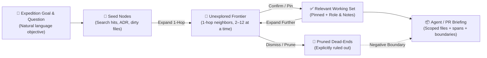

# ADR 0029: Graft Expeditions — Goal-Directed Subgraph Exploration & Persistent Working-Set Memory

- **Status**: Proposed (Future Sub-Project — Design & Architecture Roadmap)
- **Date**: 2026-11-01
- **Authors**: knightb8, Antigravity
- **Theoretical Foundation**: Corey L. Lanum, *Visualizing Graph Data* (Manning, 2017), Chapter 6, Section 6.3 (*"Data volumes: Expanding nodes to add data — draw query results, not databases"*)

---

## 1. Context & Problem Statement

In Chapter 6 (Section 6.3.1) of *Visualizing Graph Data*, Corey L. Lanum identifies the most common failure mode in graph visualization tools:

> *"The novice mistake is throwing the entire data set on the screen hoping patterns will emerge. A very powerful strategy for graph visualization is to **draw query results, not databases**. You want your users to indicate what they want to see... and then allow the user to **expand** on that graph incrementally as they explore."*

Currently, Graft's visualizers (`Cosmos`, `Stacked Flow`, `Fishbone`, `Chord Wheel`) operate primarily in **Top-Down / Whole-Graph Filtering Mode**:
1. The entire repository graph is loaded onto the canvas and filtered down via Tri-State directory checkboxes, scope chips, or a transient single-node blast trace.
2. When investigating a specific architectural question, bug, or feature design, neither the human developer nor an autonomous AI coding agent has a **persistent, goal-scoped memory** of:
   - What **question or goal** is driving the current exploration;
   - Which nodes/files have been **confirmed as relevant** (`pinned` to the working set);
   - Which nodes/files have been **inspected and ruled out as irrelevant** (`pruned` dead-ends that should stay hidden);
   - Which neighboring nodes sit on the **unexplored frontier** waiting to be triaged;
   - How to hand off that curated subgraph directly to a coding subagent without re-discovering the codebase from scratch.

Because this requires coordinated state across the CLI, on-disk storage, the interactive canvas, and agent context export, it constitutes a dedicated sub-project: **Graft Expeditions**.

---

## 2. Decision Drivers

1. **Goal-First Epistemic Framing**: Every exploration starts with an explicit natural-language **Goal / Question** (e.g., *"Trace all parser modules and BDD specs needed to support Gherkin scenario outlines"*).
2. **Progressive Ego-Network Disclosure (Lanum Ch. 6.3)**: Instead of plotting 1,000+ nodes and hiding 950 of them, an Expedition canvas starts with **only the seed nodes** (1–5 nodes) and grows organically as the user double-clicks to expand outward (2–12 neighbors per expansion) without triggering global re-layouts that destroy spatial memory.
3. **Positive & Negative Memory (Relevant vs. Pruned)**: Remembering what is *not* relevant is just as valuable as remembering what *is* relevant. Once a branch or utility module is marked **Irrelevant / Pruned**, subsequent neighborhood expansions must automatically suppress it.
4. **Human ↔ Agent Handoff**: An Expedition saved in the interactive visualizer (or assembled via CLI) should be directly consumable by an AI agent as a zero-noise context briefing (`graft expedition context <name>`), enforcing strict file boundaries.
5. **Git-Friendly Persistence**: Expeditions should serialize as clean, human-readable Markdown/JSON artifacts (e.g., under `.graft/expeditions/<slug>.expedition.json` or `docs/expeditions/`) that can optionally be committed or shared alongside an ADR or PR.

---

## 3. Proposed Architecture: The "Expedition" Model



### 3.1 Data Schema (`ExpeditionState`)

```ts
export type ExpeditionNodeStatus =
  | "seed"       // Initial entry point(s) for the question
  | "relevant"   // Confirmed part of the working set
  | "excluded"   // Explicitly ruled out / pruned dead-end
  | "frontier";  // 1-hop neighbor currently surfaced for triage

export type ExpeditionNodeRole =
  | "governance"   // Governing ADR or architectural doc
  | "spec"         // BDD .feature specification
  | "target-edit"  // Production source file to be modified
  | "contract"     // Read-only dependency interface / type contract
  | "verification" // Test file covering the behavior
  | "context";     // General reference

export interface ExpeditionEntry {
  nodeId: string;
  status: ExpeditionNodeStatus;
  role?: ExpeditionNodeRole;
  note?: string;          // Why this node is relevant or why it was ruled out
  addedAt: string;        // ISO-8601 timestamp
  discoveredVia?: {       // Provenance of how this node entered the expedition
    fromNodeId: string;
    relation: string;
  };
}

export interface ExpeditionLogStep {
  timestamp: string;
  action: "seed" | "expand" | "mark_relevant" | "mark_excluded" | "annotate";
  nodeIds: string[];
  detail?: string;
}

export interface GraftExpedition {
  id: string;             // e.g. "sankey-blast-consistency"
  title: string;          // Human-readable title
  question: string;       // The driving question / goal statement
  createdAt: string;
  updatedAt: string;
  entries: Record<string, ExpeditionEntry>;
  trail: ExpeditionLogStep[];
}
```

---

### 3.2 Interactive Canvas Workflow ("Expedition Mode" in `graft viz`)

1. **Starting an Expedition**:
   - User clicks **"New Expedition"** (or selects a node and clicks *"Start Expedition from Node"*), enters the **Goal / Question**, and picks initial seed nodes via search, git-dirty status, or ADR selection.
2. **Progressive Radial Expansion (Lanum Sec 6.3.1 & 6.4.1)**:
   - The canvas displays **only** `seed`, `relevant`, and active `frontier` nodes.
   - Double-clicking any `seed` or `relevant` node queries its immediate 1-hop neighbors in the full graph (excluding any node already marked `excluded`).
   - Following Lanum's **2-to-12 Rule**, if a node has $>12$ neighbors, they are grouped by relation/directory combo first so the canvas never explodes into a hairball.
   - New `frontier` nodes animate outward radially from the expanded parent over `280ms`, while existing nodes remain anchored in place.
3. **Triage Controls (Pin vs. Prune)**:
   - Selecting a `frontier` node offers quick single-key / badge actions:
     - **`[R]` Mark Relevant (`✓`)**: Promotes the node into the permanent working set and lets the user tag its role (`target-edit`, `contract`, `spec`, `verification`) and optional note.
     - **`[X]` Mark Irrelevant / Prune (`✕`)**: Collapses the node and its exclusively dependent subtree into the `excluded` list so it never reappears during this expedition.

---

### 3.3 CLI & Autonomous Agent Integration

Expeditions bridge visual human discovery and autonomous coding subagents:

- `graft expedition create "<title>" --question "<goal>" --seed <node-id>`
- `graft expedition status <id>` — prints the Tripartite summary of `relevant` nodes (ADRs, Specs, Code targets, Tests), `frontier` candidates, and `excluded` boundaries.
- `graft expedition export <id> --format agent-prompt` — generates a ready-to-dispatch subagent prompt containing:
  1. The **Expedition Goal & Question**;
  2. **Strict File Boundary** (`target-edit` vs. read-only `contract` files with exact `file:line` spans);
  3. **Governing ADRs & BDD `.feature` files**;
  4. **Explicit Negative Constraints** (`excluded` files that were investigated and ruled out, preventing agent drift).

---

## 4. Phased Implementation Roadmap (When Activated)

When we decide to schedule this sub-project, it divides cleanly into 3 isolated phases under **BDD Chem**:

1. **Phase A — Core Expedition Model & Persistence (`src/expedition/`)**:
   - JSON/Markdown serialization, state transitions (`seed -> frontier -> relevant | excluded`), and 1-hop frontier computation with Lanum's 2–12 cap.
2. **Phase B — CLI & Agent Briefing Generator (`src/cli.ts`)**:
   - `graft expedition` subcommands and Markdown prompt/context-bundle export.
3. **Phase C — Interactive Visualizer "Expedition Mode" (`viewer/expedition-view.ts`)**:
   - Incremental ego-network canvas, radial burst expansion animation, and quick Pin (`✓`) / Prune (`✕`) triage badges.

---

## 5. Pros and Cons

### Pros
- Directly operationalizes Lanum's highest-leverage insight for large graphs (*"Draw query results, not databases"*).
- Solves context-window bloat and file-boundary drift when handing off tasks to cheaper (`flash`) subagents.
- Preserves institutional memory of *why* certain modules were included or ruled out during debugging or architectural planning.

### Cons
- Requires persistent state management (localStorage + local filesystem sync via CLI/server) beyond static single-file HTML export.
- Warrants its own dedicated BDD feature suite and UI panel when scheduled.
